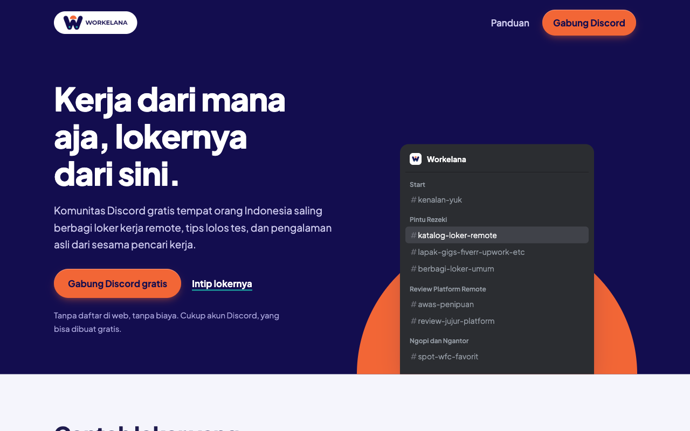
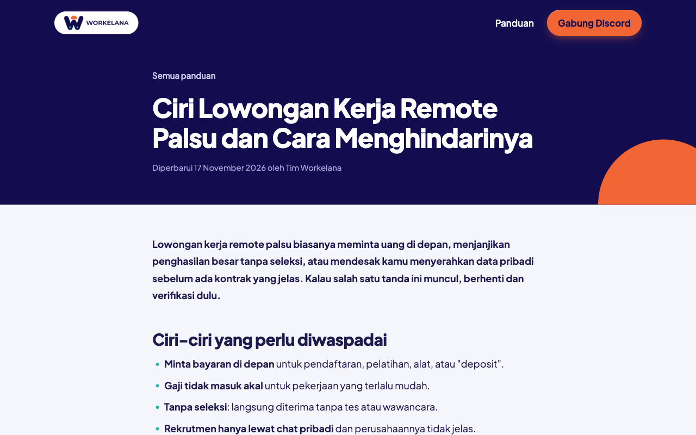

# Workelana

Website for [Workelana](https://workelana.com), a free Discord community where Indonesians share remote job openings, test tips, and honest platform reviews.

**Live site: [workelana.com](https://workelana.com)**



| Guide page | Mobile |
| --- | --- |
|  |  |

## Highlights

- **Astro + TypeScript (strictest).** Fully static output that ships **0 KB of client-side JavaScript**. The homepage is about 12 KB of HTML.
- **Typed content.** Each guide is a Markdown file validated by a Zod schema. Missing fields, bad dates, or a "related guide" that does not exist fail the build.
- **Security headers.** A strict Content Security Policy (`default-src 'none'`, self-only scripts, styles, fonts and images), plus `frame-ancestors 'none'`, `nosniff`, Referrer-Policy, Permissions-Policy and COOP. See `netlify.toml`.
- **Build-time guard.** `scripts/check-dist.mjs` runs after every build and fails it on inline scripts or styles, inline event handlers, third-party resources, broken internal links, or missing SEO tags.
- **No third parties.** Fonts are self-hosted, there is no analytics, and the privacy policy says exactly that.
- **Design system from the logo.** The rising half-sun, the pill-shaped strokes of the W and the small teal squares become the sun motifs, capsule icons, boarding-pass job cards and list bullets. Layout and color follow *Refactoring UI* principles, with WCAG AA contrast and light and dark themes.
- **SEO.** Canonical URLs, Open Graph tags, JSON-LD (`Article`, `CollectionPage`) and a sitemap generated from the content collection.

## Stack

Astro 7, TypeScript, Zod (via `astro:content`), plain CSS with custom properties, Netlify.

## Project structure

```
public/              copied as-is: favicon, robots.txt, images/
scripts/             post-build checks (check-dist.mjs)
src/
  assets/fonts/      self-hosted Plus Jakarta Sans
  components/        SiteHeader, SiteFooter, GuideCard, PromoCard
    home/            homepage sections (Hero, JobTickets, Faq, ...)
  content/panduan/   guides, one Markdown file each
  data/home.ts       homepage content
  layouts/           Base (page shell) and Article (guides, privacy)
  lib/               helpers (date formatting)
  pages/             routes: /, /panduan/, /panduan/[slug]/, /privasi/, /sitemap.xml
  styles/global.css  design tokens and all styles
  config.ts          Discord link, contact, member count, photos
```

## Running locally

```sh
npm install
npm run dev      # http://localhost:4321
npm run build    # type-check, build to dist/, then run the security checks
```

## License

© 2026 Mohamad Fauzi. All rights reserved. This code is public for viewing only; see [LICENSE](LICENSE).
